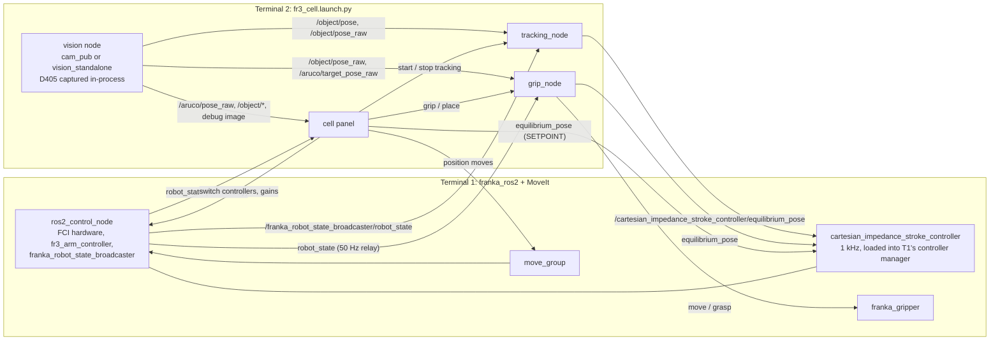

# fr3-impedance-tracking

Cartesian impedance control and vision tracking for the **Franka Research 3
(FR3)** with a wrist-mounted **Intel RealSense D405**, on **ROS 2 Humble**.
A 1 kHz Cartesian impedance controller holds the arm compliantly; a vision
node estimates the pose of a marked part from the wrist camera; a tracking
node streams the controller's equilibrium so the arm follows the part; and a
PySide6 operator panel drives all of it, one button press per motion. The
panel also runs against a mock cell, so you can try it without a robot.


## Features

- **Cartesian impedance controller** (`fr3_mating_controllers`): a
  `franka_ros2` controller plugin at 1 kHz with tool-frame stiffness, live
  gain and speed changes, slew-limited setpoints, a float (gravity-
  compensated) mode, wrench and torque caps, torque-rate limiting and a
  joint-limit wall with a speed brake.
- **Vision tracking** (`fr3_tracking`): `tracking_node` follows the part at
  50 Hz by moving the controller's equilibrium. It holds by itself on stale
  vision, at the Z floor, at the workspace box, near joint limits or past
  its lead cap, and stops on wrist buzz or if the controller is switched out.
- **Perception** (`roscam`, `object_pose_cpp`): ArUco pose from in-process
  D405 capture (no image topics on the ROS graph), the marker distance
  taken from depth, a Kalman filter in the robot base frame, a part-pose
  contract (`/object/*`), and a depth-based part estimator in C++ that can
  run in shadow mode or check the marker.
- **Operator panel** (`fr3_cell`): status chips, a single fault banner,
  camera view, force and lead plots; position-mode ALIGN through MoveIt;
  the torque ladder PRE-FLIGHT, FLOAT, HOLD, SETPOINT, TRACK; GRIP and PLACE
  with the Franka Hand; gain presets; taught poses; rosbag recording; a
  STOP NOW that is always in the same place.
- **Mock cell**: a fake robot, controller manager, MoveIt and vision on an
  isolated DDS domain, with fault injection, for trying the panel and for
  the tests.
- **Bring-up tooling**: a read-only preflight check of the RT kernel,
  network, DDS isolation and camera; a CycloneDDS profile that keeps ROS
  traffic off the robot's network link; hand-eye calibration.

## Safety

> [!WARNING]
> This software moves a real robot. Read [docs/operator_guide.md](docs/operator_guide.md)
> before you use it on an FR3.
>
> - **Nothing moves by itself.** Every motion starts from an operator button
>   press in the panel.
> - **STOP NOW is a software stop, not an emergency stop.** It halts MoveIt,
>   ends tracking and pins the equilibrium where the arm is. It has no
>   safety rating. Keep the Franka's external enabling/stop device in your
>   hand whenever the arm is powered.
> - **Tune gains with care.** Stiffness, damping and speed limits change
>   how hard and fast the arm moves. Start soft and slow, change one value
>   at a time, and stay clear of the workspace while you do.
> - The authors give no warranty (see [LICENSE](LICENSE)). You are
>   responsible for the risk assessment of your own cell.

**Status.** This is research code, run on one FR3 cell. The impedance
ladder (FLOAT, HOLD, SETPOINT), TRACK of a hand-moved marked cube, GRIP,
PLACE AT B and the controller's joint-limit wall have run on the arm. The
marker-free depth estimator runs in shadow (reporting) mode only.

## Architecture



Only one node writes the equilibrium at a time: the panel refuses its own
setpoints while TRACK or GRIP runs. More in
[docs/architecture.md](docs/architecture.md).

## Repository layout

| Path | What it is |
|---|---|
| [`fr3_mating_controllers/`](fr3_mating_controllers/) | The 1 kHz Cartesian impedance controller plugin for `franka_ros2` |
| [`fr3_tracking/`](fr3_tracking/) | `tracking_node` (vision tracking on the impedance controller) and `state_recorder` (1 kHz robot-state CSV) |
| [`roscam/`](roscam/) | Vision: `cam_pub`, `vision_standalone`, the part estimator, `depth_checked`, `handeye_calib` |
| [`object_pose_cpp/`](object_pose_cpp/) | The part estimator in C++, as a Python extension |
| [`fr3_cell/`](fr3_cell/) | The cell: launch file, parameters, DDS profile, hand-eye file, part files, the operator panel, mock cell, scripts, offline vision tools |
| [`hardware/camera_mount/`](hardware/camera_mount/) | The D405 wrist mount (STEP, CC BY 4.0, see below) |
| `docker/` | A container that runs the mock panel |
| [`docs/`](docs/) | Documentation (index below) |
| [`fr3_impedance_tracking.repos`](fr3_impedance_tracking.repos) | Source dependencies: `franka_ros2` v2.0.4, `franka_description` 1.0.1 |
| [`requirements.txt`](requirements.txt) | Python packages not available (or not new enough) as Humble debs |
| [`run_tests.sh`](run_tests.sh) | Build and run every test and linter |

## Quickstart: the panel without a robot (native)

Ubuntu 22.04 with ROS 2 Humble installed. Details and prerequisites are in
[docs/installation.md](docs/installation.md).

```bash
mkdir -p ~/fr3_ws/src && cd ~/fr3_ws/src
git clone https://github.com/knnurl/fr3-impedance-tracking.git
vcs import < fr3-impedance-tracking/fr3_impedance_tracking.repos
cd ~/fr3_ws
PKGS="fr3_cell franka_bringup franka_fr3_moveit_config franka_gripper"
rosdep install -y --ignore-src --from-paths $(colcon list --packages-up-to $PKGS --paths-only)
pip3 install -r src/fr3-impedance-tracking/requirements.txt
colcon build --symlink-install --packages-up-to $PKGS --cmake-args -DCMAKE_BUILD_TYPE=Release
source install/setup.bash
ros2 launch fr3_cell fr3_cell.launch.py mock:=true      # the panel against a fake cell, no robot
```

The mock cell and the panel run on their own DDS domain (88, loopback
only), so they cannot see or command a real robot on the same network.

## Quickstart: Docker

```bash
cd fr3-impedance-tracking
docker build -t fr3-impedance-tracking -f docker/Dockerfile .
./docker/run_mock.sh
```

`run_mock.sh` opens the mock panel on your desktop through X11. The
container is for the mock only; for a real arm, build natively on a
real-time kernel.

## Running on a real FR3

You need a PREEMPT_RT kernel, a dedicated network port for the robot,
`libfranka` matching your robot's system version, the D405 on USB, the
camera mount, a hand-eye calibration and an end-effector profile in Desk.
See [docs/installation.md](docs/installation.md) and
[docs/setup_and_calibration.md](docs/setup_and_calibration.md).

Then, from `~/fr3_ws`, in two terminals:

```bash
# Terminal 1: checks, then the FCI driver and MoveIt
source src/fr3-impedance-tracking/fr3_cell/scripts/fr3_env.sh
fr3_preflight && ros2 launch franka_fr3_moveit_config moveit.launch.py robot_ip:=$FR3_ROBOT_IP

# Terminal 2: impedance controller (inactive), hand-eye TF, vision,
# tracking_node, grip_node and the panel
source src/fr3-impedance-tracking/fr3_cell/scripts/fr3_env.sh
ros2 launch fr3_cell fr3_cell.launch.py
```

`fr3_env.sh` pins DDS to CycloneDDS with the cell's interface isolation,
sets `FR3_ROBOT_IP` (default `172.16.0.2`) and `FR3_LOG_DIR`, sources the
workspace, and defines `fr3_preflight`. The panel tour, the commissioning
ladder and the stop semantics are in
[docs/operator_guide.md](docs/operator_guide.md).

## Tests

```bash
cd ~/fr3_ws
./src/fr3-impedance-tracking/run_tests.sh
```

It builds the packages, then runs the C++ unit tests (gtest), the Python
tests (pytest: panel logic, persistence, grip geometry, vision, estimator
parity), a smoke test of the real `tracking_node` in a fake cell, and every
linter. No robot or camera is touched; tests that start ROS nodes use
their own DDS domains.

## Documentation

| Document | Contents |
|---|---|
| [docs/installation.md](docs/installation.md) | Requirements, native build step by step, Docker, troubleshooting |
| [docs/operator_guide.md](docs/operator_guide.md) | Bring-up, panel tour, shortcuts, stops, safety rules, taught poses, logs |
| [docs/setup_and_calibration.md](docs/setup_and_calibration.md) | Network, RT and DDS, preflight, Desk, camera mount, hand-eye, markers, part files |
| [docs/controller.md](docs/controller.md) | The Cartesian impedance controller |
| [docs/tracking.md](docs/tracking.md) | `tracking_node`: the tracking law, holds and stops |
| [docs/perception.md](docs/perception.md) | Vision: capture, ArUco, filtering, the part estimator |
| [docs/architecture.md](docs/architecture.md) | Nodes, topics, services and how they fit together |
| [CONTRIBUTING.md](CONTRIBUTING.md) | How to contribute |

## Licence and third-party material

This repository is licensed under the [Apache License 2.0](LICENSE),
copyright Kaan Ural.

The D405 camera mount in `hardware/camera_mount/franka_D405_camera_mount.step`
is "Realsense D405 Camera Mount for Franka Robot Arms" by **Lele Burger**,
from [MakerWorld](https://makerworld.com/en/models/1925363-realsense-d405-camera-mount-for-franka-robot-arms),
licensed under [CC BY 4.0](https://creativecommons.org/licenses/by/4.0/)
and included unmodified. It is not covered by the Apache License. See
[NOTICE](NOTICE).

`franka_ros2` and `franka_description` are fetched from Franka Robotics'
repositories under their own licences.
