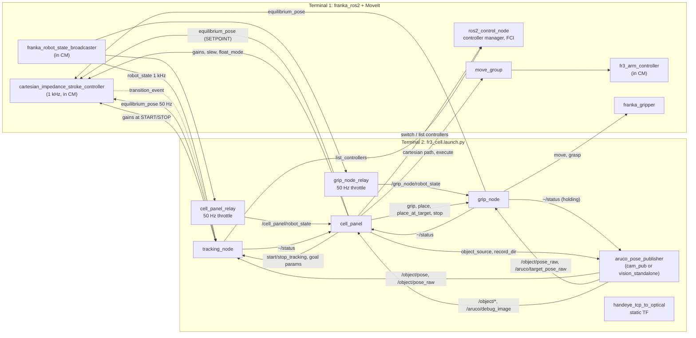

# Architecture

This page shows the processes and nodes of the cell, the topics, services and
parameters between them, how DDS is kept off the robot's network link, and
where files are written. The details of each part are in
[controller.md](controller.md), [tracking.md](tracking.md) and
[perception.md](perception.md).

## Contents

- [Processes](#processes)
- [Nodes](#nodes)
- [Topics](#topics)
- [Services and actions](#services-and-actions)
- [Parameters written at run time](#parameters-written-at-run-time)
- [Who moves the arm](#who-moves-the-arm)
- [DDS isolation and domains](#dds-isolation-and-domains)
- [Files written](#files-written)

## Processes

The cell runs in **two terminals**, each with
`fr3_cell/scripts/fr3_env.sh` sourced (the order and the checks are in
[operator_guide.md](operator_guide.md)).

| Terminal | Command | Runs |
|---|---|---|
| 1 | `ros2 launch franka_fr3_moveit_config moveit.launch.py robot_ip:=$FR3_ROBOT_IP` | The `franka_ros2` driver: `ros2_control_node` with the FCI hardware interface, `fr3_arm_controller`, `franka_robot_state_broadcaster`, `joint_state_broadcaster`; `robot_state_publisher`; MoveIt's `move_group`; the Franka Hand's `franka_gripper`. |
| 2 | `fr3_cell` (= `ros2 launch fr3_cell fr3_cell.launch.py`) | Everything in this repository, below. |

Terminal 2 starts, from [`fr3_cell/launch/fr3_cell.launch.py`](../fr3_cell/launch/fr3_cell.launch.py):

1. a `controller_manager spawner` that loads and configures
   `cartesian_impedance_stroke_controller` **inactive** into terminal 1's
   controller manager, with
   `fr3_mating_controllers/config/cartesian_impedance_stroke.yaml`, then
   exits;
2. `handeye_tcp_to_optical`, a static TF `fr3_hand_tcp` to
   `camera_color_optical_frame` from `fr3_cell/calib/handeye.yaml`;
3. the vision node (`cam_pub` or `vision_standalone`, by `vision_source`);
4. after 3 s: `tracking_node`, `grip_node` and the panel (`cell.py`), all
   with `fr3_cell/config/fr3_params.yaml`.

Nothing in terminal 2 moves the arm by itself: every motion is a panel
button. Because the controller lives in terminal 1's controller manager, the
terminal that runs the driver must have this workspace sourced, or the
spawner fails with "Loader for controller ... not found".

`fr3_cell mock:=true` starts none of that. It runs `mock_cell.py` (a fake
robot, controller manager, MoveIt, vision and tracking node) and the panel,
both on an isolated DDS domain. Terminal 1 is not needed.

## Nodes

| Node | Package | Role |
|---|---|---|
| `cartesian_impedance_stroke_controller` | `fr3_mating_controllers` | 1 kHz Cartesian impedance law; holds the arm on a spring around the equilibrium. |
| `fr3_arm_controller` | `franka_ros2` | Joint trajectory controller for MoveIt's position moves (ALIGN). Never active together with the impedance controller. |
| `aruco_pose_publisher` | `roscam` | Owns the D405; marker poses, the object pose contract, the depth estimator. |
| `tracking_node` | `fr3_tracking` | Streams the equilibrium at 50 Hz to follow the part; idle until START. |
| `grip_node` | `fr3_cell` (`cell/grip_node.py`) | GRIP, PLACE and PLACE AT B with the Franka Hand on the impedance controller; idle until called. |
| `cell_panel` | `fr3_cell` (`cell/cell.py`) | The PySide6 operator panel: every command, the controller switches, the gains. Refuses to start while another `cell_panel` is up. |
| `cell_panel_relay`, `grip_node_relay` | `topic_tools` | C++ `throttle` children that relay the 1 kHz robot state at 50 Hz; decoding it at 1 kHz in Python would cost most of a core. They die with their parent. |
| `handeye_tcp_to_optical` | `tf2_ros` | The hand-eye calibration as a static transform. |
| `state_recorder` | `fr3_tracking` | Optional, started by hand: 1 kHz robot state to CSV. Publishes and calls nothing. |

## Topics

| Topic | Type | Publisher | Subscribers |
|---|---|---|---|
| `/franka_robot_state_broadcaster/robot_state` | `franka_msgs/FrankaRobotState` | `franka_robot_state_broadcaster` (1 kHz) | `tracking_node`, the two relays, `state_recorder` |
| `/cell_panel/robot_state` | `franka_msgs/FrankaRobotState` | `cell_panel_relay` (50 Hz) | `cell_panel` (best effort, depth 1) |
| `/grip_node/robot_state` | `franka_msgs/FrankaRobotState` | `grip_node_relay` (50 Hz) | `grip_node` (best effort, depth 1) |
| `/joint_states` | `sensor_msgs/JointState` | `joint_state_broadcaster` | `cell_panel`, `robot_state_publisher` |
| `/robot_description` | `std_msgs/String` (latched) | `robot_state_publisher` | `cell_panel` (joint limits) |
| `/tf`, `/tf_static` | `tf2_msgs/TFMessage` | `robot_state_publisher`, `handeye_tcp_to_optical` | vision node, `tracking_node`, `grip_node`, `cell_panel` |
| `/cartesian_impedance_stroke_controller/equilibrium_pose` | `geometry_msgs/PoseStamped` | `tracking_node`, `grip_node`, `cell_panel` | the impedance controller |
| `/cartesian_impedance_stroke_controller/transition_event` | `lifecycle_msgs/TransitionEvent` | the impedance controller (lifecycle) | `tracking_node`, `cell_panel` |
| `/aruco/pose` | `geometry_msgs/PoseStamped` (`fr3_link0`) | vision node | (recorded by REC) |
| `/aruco/pose_raw` | `geometry_msgs/PoseStamped` (optical) | vision node | `handeye_calib` when calibrating |
| `/aruco/target_pose_raw` | `geometry_msgs/PoseStamped` (optical) | vision node | `grip_node` |
| `/aruco/debug_image` | `sensor_msgs/Image` | vision node (only while subscribed, at most 5 Hz) | `cell_panel` (only while the camera view is on) |
| `/object/pose` | `geometry_msgs/PoseStamped` (`fr3_link0`) | vision node | `tracking_node`, `cell_panel` |
| `/object/pose_raw` | `geometry_msgs/PoseStamped` (optical) | vision node | `tracking_node`, `grip_node`, `cell_panel` |
| `/object/pose_quality` | `diagnostic_msgs/DiagnosticArray` | vision node | `cell_panel` |
| `/tracking_node/status` | `diagnostic_msgs/DiagnosticStatus` (latched) | `tracking_node` | `cell_panel` |
| `/grip_node/status` | `diagnostic_msgs/DiagnosticStatus` (latched) | `grip_node` | `cell_panel`, `vision_standalone` |
| `/trajectory_execution_event` | `std_msgs/String` | `cell_panel` | `move_group` ("stop" halts a trajectory mid-motion) |
| `/cell_panel/heartbeat` | `std_msgs/Header` | `cell_panel` (10 Hz, from the GUI thread) | none yet |
| `/mock_cell/fault` | `std_msgs/String` | `cell_panel` (mock only) | `mock_cell` |

## Services and actions

| Name | Type | Server | Clients |
|---|---|---|---|
| `/tracking_node/start_tracking`, `/tracking_node/stop_tracking` | `std_srvs/Trigger` | `tracking_node` | `cell_panel` |
| `/grip_node/grip`, `/grip_node/place`, `/grip_node/place_at_target` | `std_srvs/Trigger` (block until done) | `grip_node` | `cell_panel` |
| `/grip_node/stop` | `std_srvs/Trigger` (answers at once) | `grip_node` | `cell_panel` |
| `/cartesian_impedance_stroke_controller/set_parameters_atomically` | `rcl_interfaces/SetParametersAtomically` | the impedance controller | `cell_panel`, `tracking_node` |
| `/cartesian_impedance_stroke_controller/get_parameters` | `rcl_interfaces/GetParameters` | the impedance controller | `cell_panel`, `tracking_node`, `grip_node` |
| `/controller_manager/list_controllers` | `controller_manager_msgs/ListControllers` | controller manager | `cell_panel`, `tracking_node` |
| `/controller_manager/switch_controller` | `controller_manager_msgs/SwitchController` | controller manager | `cell_panel` |
| `/service_server/set_load`, `/service_server/set_force_torque_collision_behavior` | `franka_msgs` services | `franka_ros2` hardware | `cell_panel` (PRE-FLIGHT) |
| `/action_server/error_recovery` | `franka_msgs/action/ErrorRecovery` | `franka_ros2` hardware | `cell_panel` (RECOVER) |
| `/compute_cartesian_path` | `moveit_msgs/GetCartesianPath` | `move_group` | `cell_panel` (ALIGN) |
| `/execute_trajectory` | `moveit_msgs/action/ExecuteTrajectory` | `move_group` | `cell_panel` (ALIGN) |
| `/franka_gripper/move`, `/franka_gripper/grasp` | `franka_msgs` actions | `franka_gripper` | `grip_node` |

## Parameters written at run time

| Target | Parameters | Written by | When |
|---|---|---|---|
| impedance controller | `k_pos_tool`, `k_rot_tool`, `damping_ratio` | `cell_panel` | APPLY, a preset, and the saved gains at FLOAT/HOLD (atomic) |
| impedance controller | `setpoint_slew_mps`, `setpoint_slew_rps` | `cell_panel` | the speed sliders, at every activation and during TRACK |
| impedance controller | `float_mode` | `cell_panel` | FLOAT, HOLD |
| impedance controller | the profile slew, and `damping_ratio` capped at 0.5 if it was higher (or the whole `track_*` profile when `tracking_use_operator_gains` is false) | `tracking_node` | START; the snapshot of gains and slew is restored at STOP |
| `tracking_node` | `tracking_standoff_m`, `tracking_inplane_deg` or `tracking_inplane_hold`, `tracking_over_lead_policy`, `tracking_box_*` | `cell_panel` | before every START (atomic) |
| `tracking_node` | `tracking_over_lead_policy` | `cell_panel` | the over-lead dropdown, live |
| `grip_node` | `grip_cube_m`, `grip_force_n`, `grip_target_slot`, `tracking_box_*` | `cell_panel` | before every GRIP, PLACE, PLACE AT B (atomic) |
| `aruco_pose_publisher` | `object_source` | `cell_panel` | the source dropdown, only while nothing reads the pose for motion |
| `aruco_pose_publisher` | `record_dir` | `cell_panel` | REC on and off (`vision_standalone` only) |

## Who moves the arm

Only two things command the arm: MoveIt through `fr3_arm_controller`
(position moves, ALIGN) and the impedance controller (everything in torque
mode). The panel switches between them with `switch_controller` (STRICT), and
hands the arm back to `fr3_arm_controller` when it exits.

On the impedance controller, three nodes can publish the equilibrium, and the
controller takes the last message it received. The panel keeps them apart:
it refuses its own setpoints while TRACK or GRIP runs, and refuses TRACK and
GRIP while the other runs. `tracking_node` and `grip_node` publish only while
a session or sequence runs, and each hold or stop publishes the arm's own
pose once.

## DDS isolation and domains

The FCI loop exchanges a UDP packet with the robot every 1 ms. ROS traffic
on the same network link, or in the same kernel buffers, makes it miss
deadlines, and the robot stops with a communication reflex. Three measures
keep DDS away from it:

- **Interface pinning.** `fr3_env.sh` sets
  `RMW_IMPLEMENTATION=rmw_cyclonedds_cpp` and `CYCLONEDDS_URI` to
  [`fr3_cell/config/cyclonedds_fr3.xml`](../fr3_cell/config/cyclonedds_fr3.xml),
  whose `<Interfaces>` block lists only the interfaces DDS may use (loopback,
  optionally a second NIC for remote tools), never the robot's. Edit it for
  your interface names, then check it with `fr3_preflight`.
- **No image topics.** The camera is captured in-process; only poses and a
  throttled, subscribe-gated debug image are published
  ([perception.md](perception.md)).
- **Low-rate readers.** The panel and grip node read the robot state through
  50 Hz relays, best effort, depth 1, so a slow reader cannot back-pressure
  the driver.

The real cell runs on the default `ROS_DOMAIN_ID` (0). Everything that runs
without the robot re-executes itself onto its own domain, over loopback only,
so it cannot see or command a live cell whatever the shell has sourced:

| Domain | Used by |
|---|---|
| 0 (default) | the real cell |
| 88 | the mock cell and a `--mock` panel (`fr3_cell/cell/isolate.py`), `mock_smoke.py`, the panel's recorder test, and the offline replay tools `replay_eval.py` and `loop_replay.py` |
| 87 | `fr3_cell/sim/tracking_smoke.py` (the real `tracking_node` in a fake cell) |

## Files written

`fr3_env.sh` sets `FR3_LOG_DIR` (default `~/.local/share/fr3_cell/runs`;
set it before sourcing to move it). Run logs go to one folder per day,
`$FR3_LOG_DIR/YYYY-MM-DD/`:

| File | Written by | What |
|---|---|---|
| `cell_YYYYmmdd_HHMMSS.jsonl` | `cell_panel` | The panel's session trace: ladder events, ALIGN iterations, TRACK as the panel saw it, 50 Hz samples while impedance holds the arm. |
| `tracking_YYYYmmdd_HHMMSS.jsonl` | `tracking_node` | One line per 50 Hz tick of a TRACK session ([format](tracking.md#tracking-log)). |
| `grip_YYYYmmdd_HHMMSS_ffffff.jsonl` | `grip_node` | One trace per GRIP, PLACE or PLACE AT B. |
| `bag_YYYYmmdd_HHMMSS/` | `cell_panel` REC | `ros2 bag` of the relayed state, poses, statuses, TF, equilibrium, parameter events and the gripper joints. Not the 1 kHz state, not images. |
| `vision/vision_YYYYmmdd_HHMMSS/` | `vision_standalone`, on REC | The camera's own frames ([format](perception.md#recording-frames)). |
| `state_YYYYmmdd_HHMMSS.csv` and `.json` | `state_recorder` | 1 kHz robot state, when you run it. |

Without `FR3_LOG_DIR`:

- the panel's traces, the grip traces and the bags go to
  `~/.local/share/fr3_cell/logs/`;
- `tracking_node` writes no log (its `tracking_log_dir` is empty);
- `state_recorder` writes to `./YYYY-MM-DD/` in its working directory.

Settings, kept across restarts, in `~/.config/fr3_cell/` (or
`$XDG_CONFIG_HOME/fr3_cell/`):

| File | What |
|---|---|
| `settings.yaml` | The panel's settings drawer and the last gains applied, saved on every change. Delete it to go back to the defaults in `fr3_cell/cell/config/settings.yaml`. |
| `settings_mock.yaml` | The same for the mock cell, so a mock session never changes the real one. |
| `poses.yaml` | Poses taught in the panel. |

The speed sliders and the robot-state gate are deliberately not kept: they
start at their safe defaults on every launch.

Summarise any of the jsonl logs with
`python3 fr3_cell/scripts/analyse_trace.py [file ...]` (with no argument, the
newest under `$FR3_LOG_DIR`, else under `~/.local/share/fr3_cell/logs`).
