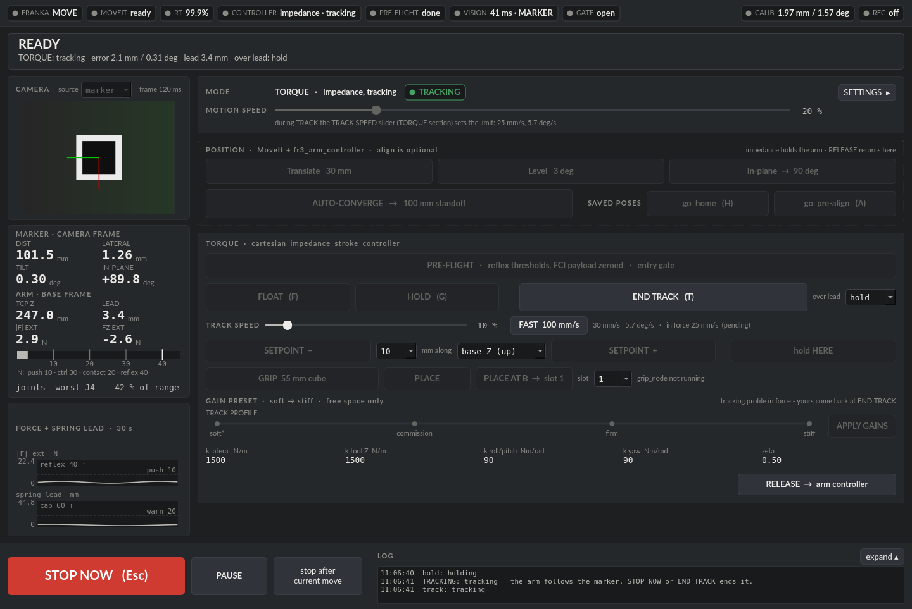

# Operator guide

How to bring the cell up, what the panel shows, what each button does, and
how to stop. Read [Safety rules](#safety-rules) before your first session.
One-time setup (network, Desk, calibration) is in
[setup_and_calibration.md](setup_and_calibration.md).

## Before you power anything

- **The Franka's external enabling/stop device is in your hand** whenever
  the arm is powered. The panel's STOP NOW is not a substitute.
- **Mains power** if the PC is a laptop. On battery the CPU cannot hold its
  clocks and the 1 ms FCI deadline slips; `fr3_preflight` fails on battery.
- **RT throttling off**: `cat /proc/sys/kernel/sched_rt_runtime_us` prints
  `-1` (see [installation.md](installation.md#8-real-arm-only-one-time-pc-setup)).
- **Desk**: unlock the joints, activate FCI, then **close the Desk browser
  tab**. Its HTTPS connections share the robot link; `fr3_preflight` warns
  while one is open.
- **Payload lives in Desk**, in the active end-effector profile (Hand plus
  camera and mount). The panel's PRE-FLIGHT sets the FCI payload to zero, so
  the load is never counted twice.

## Bring-up: two terminals

Run both from your workspace (here `~/fr3_ws`).

```bash
# Terminal 1: preflight; the driver and MoveIt start only with 0 FAILs
source src/fr3-impedance-tracking/fr3_cell/scripts/fr3_env.sh
fr3_preflight && ros2 launch franka_fr3_moveit_config moveit.launch.py robot_ip:=$FR3_ROBOT_IP
```

```bash
# Terminal 2: the cell
source src/fr3-impedance-tracking/fr3_cell/scripts/fr3_env.sh
ros2 launch fr3_cell fr3_cell.launch.py
```

`fr3_env.sh` sets the CycloneDDS profile that keeps ROS traffic off the
robot NIC, `FR3_ROBOT_IP` (default `172.16.0.2`) and `FR3_LOG_DIR`, sources
the workspace and defines `fr3_preflight`. Source it in **every** terminal
that talks to the cell, including ones where you run `ros2 topic` or
`state_recorder`.

Terminal 2 starts:

- the spawner, which loads `cartesian_impedance_stroke_controller` into
  terminal 1's controller manager **inactive** and exits;
- the hand-eye static TF from `fr3_cell/calib/handeye.yaml` (the log line
  says which values were used);
- the vision node, capturing the D405 in-process (no image topics);
- `tracking_node` (idle until TRACK) and `grip_node` (idle until GRIP);
- the panel.

Nothing in terminal 2 moves the arm by itself.

### Launch arguments you may need

List them all with `ros2 launch fr3_cell fr3_cell.launch.py --show-args`.

| Argument | Default | Use |
|---|---|---|
| `mock` | `false` | `true`: the panel against a fake cell, no robot |
| `start_panel` | `true` | `false`: start the panel yourself |
| `marker_id` | `0` | ArUco id of the tracked part's marker (`DICT_6X6_250`) |
| `target_marker_id` | `1` | ArUco id of target B for PLACE AT B; `-1` turns it off |
| `vision_source` | `realsense` | `standalone`: the same capture run by `vision_standalone` (needed for the depth estimator modes); `topic`: a separate `realsense2_camera` driver, colour only |
| `capture_fps` | `15` | D405 capture rate; also the pose rate |
| `range_source` | `depth` | `aruco`: marker distance from ArUco alone (the launch then uses the matching hand-eye translation) |
| `handeye_xyz`, `handeye_quat` | from `handeye.yaml` | try a candidate calibration without editing the file |
| `vision_cpus` | `12-19` | CPU list the vision process is pinned to (`''` = not pinned); set it to cores your PC has, away from the control loop |
| `params_file` | `fr3_cell/config/fr3_params.yaml` | node parameters for `tracking_node` and `grip_node` |

### Check that it came up

```bash
ros2 control list_controllers   # fr3_arm_controller active,
                                # cartesian_impedance_stroke_controller inactive
ros2 topic hz /aruco/pose       # only while the marker is in view
ros2 topic hz /object/pose      # the same pose, as TRACK and GRIP read it
```

If the camera view shows frames but `/aruco/pose` is silent, the marker is
not being detected: check `marker_id` and the print.

### Relaunching and shutting down

- **Relaunching terminal 2** while terminal 1 runs is safe. If the impedance
  controller is active, the spawner prints "Failed to configure controller"
  and leaves it untouched; that is expected.
- **Restarting terminal 1** (for example after a reflex) is fine: about 15 s
  after the controller manager comes back without the impedance controller,
  the panel loads it again, inactive.
- **Edits to the controller's YAML** take effect only after restarting
  terminal 1, then terminal 2.
- **Ctrl-C in terminal 2** lets the panel hand the arm back to
  `fr3_arm_controller` before it exits: normally about a second, up to about
  a minute if a service is not answering. Do not kill it meanwhile.

## The panel



The panel runs as the ROS node `cell_panel`. It refuses to start while
another `cell_panel` is on the graph, so two panels never drive one arm.

### Status bar and banner

Seven chips, always the same and in the same place:

| Chip | Shows |
|---|---|
| FRANKA | robot mode (MOVE, IDLE, REFLEX, ...), or `no state` / `stale` |
| MOVEIT | `ready` or `down` |
| RT | the FCI command success rate while the robot is in MOVE |
| CONTROLLER | `fr3_arm_controller`, `impedance · float/hold/tracking`, `none active` or `both active` |
| PRE-FLIGHT | `unknown`, `needed` or `done` for this driver session |
| VISION | pose age, the pose source, and the depth check when one runs |
| GATE | the robot-state gate: `open`, `blocked`, `paused`, `off` or `reflex` |

Then **CALIB** (hand-eye residuals; click for details) and **REC** (click
to start or stop a rosbag). A **MOCK** badge shows in mock mode.

Below the bar, the **banner** shows the single highest-priority fault, or
READY and the mode. When a robot error can be cleared, it offers
**RECOVER**.

### Left column

The camera view (click to enlarge; it enlarges itself on stale frames or a
pose jump), telemetry, a force bar against this session's PRE-FLIGHT
thresholds, the worst joint, and plots: convergence in position mode,
force and lead in torque mode. The **source** dropdown above the camera
picks the pose source (`marker` or `depth_checked`); it changes only while
nothing is moving on that pose.

### MODE and MOTION SPEED

The speed slider starts at 20 % on every launch. In position mode it scales
the next MoveIt move (100 % is 40 % of MoveIt's planned speed). In torque
mode it sets the controller's setpoint speed limit, and above 25 % it asks
for a confirm click. **SETTINGS ▸** opens the drawer.

### POSITION section (MoveIt and `fr3_arm_controller`)

ALIGN brings the camera to a target standoff above the marker (100 mm by
default), square to it and at a chosen in-plane angle. It moves only on a
fresh, raw (not predicted) marker pose, inside the workspace box and above
the Z floor.

| Button | Does |
|---|---|
| Translate | one step toward the standoff point, at most the drawer's step size |
| Level | one rotation step that squares the camera to the marker |
| In-plane | one rotation step about the optical axis to the target angle (`off` disables it) |
| AUTO-CONVERGE | repeats the steps until within tolerance (needs a Z floor set) |
| go home, go pre-align | move to a taught pose in a straight line; a move longer than 50 mm asks for a confirm |

ALIGN is optional: TRACK and GRIP only need the marker in view and close
enough.

### TORQUE section (`cartesian_impedance_stroke_controller`)

Work down it in this order the first time on a cell, and after any change
to the controller, the payload or the gains.

| Button | Does | Needs |
|---|---|---|
| PRE-FLIGHT | Briefly releases `fr3_arm_controller` so the robot goes idle, sets the FCI payload to zero and the collision thresholds (contact 20 N, reflex 40 N), then restores the arm controller and reports the external force at rest | the arm still, impedance not active. Once per driver session |
| FLOAT | Switches to the impedance controller with no spring (Coriolis compensation only; the robot compensates gravity): the arm is weightless and you can move it by hand | PRE-FLIGHT done |
| HOLD | Switches to (or stays on) the impedance controller holding where the arm is now | PRE-FLIGHT done |
| SETPOINT − / + | Moves the equilibrium by the chosen step (5-50 mm) along base Z, X, Y or tool Z; the arm glides there at the speed limit | HOLD |
| hold HERE | Re-seeds the equilibrium at the arm's current pose | HOLD |
| TRACK / END TRACK | Starts `tracking_node`: the arm follows the part. Pressed again it ends tracking and restores your gains. The **over lead** dropdown sets what happens when the part is further than the 60 mm lead cap: `hold` waits, `stop` ends, `clamp` follows capped | HOLD, the marker in view within 30 mm and 5° of the standoff target |
| TRACK SPEED, FAST | The speed limit while tracking (10 % on every launch). FAST raises it to 100 mm/s while tracking and switches itself off when tracking ends | |
| GRIP | Reads the cube pose once from the marker, opens the Hand, glides above the cube, descends, grasps and lifts | HOLD, the marker in view |
| PLACE | Reverses GRIP: sets the held cube back down and opens | holding a cube |
| PLACE AT B, slot | Carries the held cube to target marker B and sets it down in slot 1 or 2 | holding a cube; B seen in the last 10 minutes |
| GAIN PRESET, APPLY GAINS | A detented slider from soft to stiff; it changes gains only in free space (under 5 N and 5 mm of spring lead) | not while tracking |
| RELEASE → arm controller | Ends tracking if needed and hands the arm back to `fr3_arm_controller` | |

Things to know:

- **It will not reach a setpoint exactly.** Joint friction leaves a
  deadband of roughly friction force divided by stiffness: several mm at
  low stiffness. That is physics, not a fault.
- **TRACK holds by itself** (and resumes when the reason clears) on stale
  vision, at the Z floor, at the workspace box, near a joint limit, or past
  the lead cap under `hold`. It **stops by itself** on wrist buzz or when
  the impedance controller leaves ACTIVE. TRACK keeps the gains you applied.
- **The settings drawer** has the target and safety values, the workspace
  box, the robot-state gate checkbox (ON at every launch), step sizes, TRACK
  entry and marker-loss policy, GRIP cube size and force, numeric gains
  (pending until APPLY), TEACH buttons, the calibration, the camera, and in
  mock mode the fault injection. Its values are saved on every change to
  `~/.config/fr3_cell/settings.yaml` (`settings_mock.yaml` for the mock);
  delete the file to reset. The speed sliders and the gate are never
  restored: they start at their safe defaults.

### Stop bar

The bar at the bottom never moves:

| Control | Effect |
|---|---|
| **STOP NOW** (or **Esc** anywhere in the window) | Halts MoveIt mid-move, ends tracking, stops GRIP/PLACE where the arm is (the Hand is left as it is), turns FLOAT into a hold, and pins a gliding setpoint where the arm is. It never releases the arm. |
| **PAUSE / RESUME** | Position mode: halts and keeps the run, to resume from rest. Torque mode: pins the equilibrium where the arm is. While tracking it ends tracking (there is no pause in `tracking_node`); during GRIP/PLACE it stops the sequence. |
| **stop after current move** | Lets the current move finish and starts nothing after it. While tracking, it ends tracking. |

> STOP NOW is a **software stop**. It has no safety rating and depends on
> the PC, ROS and the controller working. The Franka's external
> enabling/stop device is the safety function.

The log beside the stop bar shows three lines; **expand ▴** shows more.
Every refused press logs why it was refused.

### Keyboard shortcuts

| Key | Same as |
|---|---|
| **Esc** | STOP NOW, from anywhere in the window, even inside a field |
| H | go home |
| A | go pre-align |
| T | TRACK / END TRACK |
| F | FLOAT |
| G | HOLD |

H, A, T, F and G act like a click on the button (refusals and confirms
included). They are ignored while you type in a field or while a dropdown
or dialog is open, and on key repeat.

## Safety rules

1. Keep the external enabling/stop device in hand whenever the arm is
   powered. Stay out of the arm's reach unless you are deliberately guiding
   it in FLOAT or HOLD.
2. Every motion is one button press. Know what the button does before you
   press it; read the refusal in the log if it does nothing.
3. Run PRE-FLIGHT in every driver session. If the external force at rest
   is above about 5 N, fix the payload in Desk before FLOAT.
4. In FLOAT and HOLD, keep hand pushes under about 10 N.
5. Change gains in free space only, one step at a time. Keep damping
   (`zeta`) at or below 1.0. Raise stiffness and speed gradually; a buzz,
   kick or ringing means stop and go softer.
6. Keep the speed sliders low until the cell has proven itself; above 25 %
   the panel asks for a confirm.
7. Watch the RT chip. Below 99 % something is loading the PC or the network;
   below 95 % the banner says RT DEGRADED. Stop and investigate.
8. Use RELEASE to hand the arm back before you leave the cell.

## Taught poses

The panel has two saved poses, `home` and `pre_align`. Teach them in the
settings drawer (**TEACH home**, **TEACH pre-align**) with the arm where you
want it; go there with **go home** / **go pre-align** (or H / A). The moves
use ALIGN's straight-line path and the Z floor, and need `fr3_arm_controller`
active.

They are stored in `~/.config/fr3_cell/poses.yaml` (under
`$XDG_CONFIG_HOME` if set), beside the saved settings, one entry per pose
with the TCP position, orientation and time taught:

```yaml
home:
  xyz: [0.45, 0.0, 0.40]                 # m, fr3_link0
  quat_xyzw: [1.0, 0.0, 0.0, 0.0]
  taught: '2025-01-01T12:00:00'
```

## Logs and recording

Logs go to `$FR3_LOG_DIR/YYYY-MM-DD/` when `FR3_LOG_DIR` is set (as
`fr3_env.sh` does). Without it, the panel and `grip_node` write to
`~/.local/share/fr3_cell/logs` and `tracking_node` writes no log.

| File | Written by |
|---|---|
| `cell_*.jsonl` | the panel: session events, ALIGN steps, the ladder, TRACK as the panel saw it |
| `tracking_*.jsonl` | `tracking_node`, one per TRACK run, per tick |
| `grip_*.jsonl` | `grip_node`, one per GRIP, PLACE or PLACE AT B |
| `bag_*` | the REC chip |
| `state_*.csv`, `state_*.json` | `state_recorder` |

Summarise a trace (with no argument, the newest one):

```bash
python3 src/fr3-impedance-tracking/fr3_cell/scripts/analyse_trace.py [log.jsonl ...]
```

**REC** records a rosbag with the robot state at 50 Hz, the poses, the
equilibrium, tracking and grip status, controller transitions, TF and
parameter events (every gain and speed change). It does not record images
or the 1 kHz robot state.

For the full-rate robot state (joint positions, velocities, torques,
external wrench, commanded torque) run the 1 kHz recorder in another
terminal. Start it **before** REC so the two overlap:

```bash
ros2 run fr3_tracking state_recorder                              # until Ctrl-C
ros2 run fr3_tracking state_recorder --ros-args -p duration_s:=60.0
```

It writes `state_<time>.csv` (and a `.json` with the inertia and frame
data) to `$FR3_LOG_DIR/YYYY-MM-DD/`, or to a dated folder in the current
directory when `FR3_LOG_DIR` is unset; `-p out:=<path>` overrides both. It
only subscribes; it publishes and calls nothing.

## Trying it without a robot

```bash
ros2 launch fr3_cell fr3_cell.launch.py mock:=true
```

The mock cell fakes the robot state, the controller manager, MoveIt, the
impedance controller's parameters, the vision topics and a tracking node,
on DDS domain 88 over loopback. The drawer's **MOCK FAULTS** group injects
faults (reflex, driver down, stale vision, lost marker, pose jump, RT dip,
user stop, push, MoveIt down) so you can see how the panel reacts.
