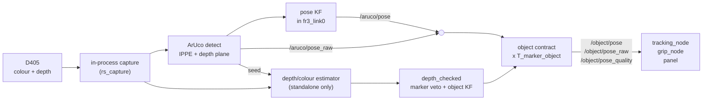

# Perception

The vision side finds the part the arm works on and publishes its pose for
the tracking node, the grip node and the panel. It runs as one ROS node,
`aruco_pose_publisher`, in package `roscam`. That node owns the wrist
RealSense D405 and captures it **in-process**: colour and depth frames never
go on the ROS graph, only poses and a throttled debug image do. Image
traffic on DDS competes with the 1 kHz FCI loop, so not creating it is the
first line of defence.

Today the part is a 55 mm cube with an ArUco marker on its top face. The
marker drives everything. A depth and colour estimator of the part's pose
runs beside it, either reporting only (shadow mode) or driving with the
marker able to veto it (`depth_checked`). A marker-free acquisition step
exists, in shadow mode only.

## Contents

- [Pipeline](#pipeline)
- [Camera owners (`vision_source`)](#camera-owners-vision_source)
- [The marker path](#the-marker-path)
- [The object pose contract](#the-object-pose-contract)
- [Part files](#part-files)
- [The depth and colour estimator](#the-depth-and-colour-estimator)
- [Shadow mode](#shadow-mode)
- [`depth_checked`](#depth_checked)
- [Marker-free acquisition (shadow only)](#marker-free-acquisition-shadow-only)
- [The C++ estimator](#the-c-estimator)
- [Recording frames](#recording-frames)
- [Offline evaluation tools](#offline-evaluation-tools)
- [Other nodes in `roscam`](#other-nodes-in-roscam)
- [Limitations](#limitations)

## Pipeline



## Camera owners (`vision_source`)

The cell launch picks who owns the camera with `vision_source`. All three
run the same `ArucoPosePublisher` with the same parameters, under the node
name `aruco_pose_publisher`.

| `vision_source` | Executable | What it does |
|---|---|---|
| `realsense` (default) | `cam_pub` with `source: realsense` | In-process pyrealsense2 capture with depth. Marker path only. |
| `standalone` | `vision_standalone` | The same capture and marker path, plus the depth estimator (shadow mode, `depth_checked`, acquisition shadow) and frame recording. |
| `topic` | `cam_pub` with `source: topic` | A separate `realsense2_camera` driver publishes colour only (`fr3_cell/config/realsense_low_bw.yaml`). No depth: the depth-based tilt and range fall back to ArUco alone. |

```bash
fr3_cell vision_source:=standalone object_shadow:=true
```

The launch runs the vision process with one BLAS thread and pins it to the
CPUs in `vision_cpus` (default `12-19`; `''` to unpin), away from the 1 kHz
control loop. Change the CPU list for your machine.

## The marker path

`cam_pub.py`, per frame:

1. **Detect** the marker (`aruco_dictionary` `DICT_6X6_250`, `marker_id`,
   launch default 0, side `marker_size_m` 0.021 m). Every other id is
   discarded, so a wrong id looks exactly like "no marker". Detections with a
   reprojection error over `max_reprojection_error_px` (2 px) are dropped.
2. **Solve** the pose with `SOLVEPNP_IPPE_SQUARE`. A small, nearly
   fronto-parallel square has two IPPE solutions with mirrored tilt, and the
   one OpenCV returns flips from frame to frame. A plane fitted to the depth
   around the marker has one normal, so it picks the real solution
   (`tilt_disambiguation: depth`; it falls back to locking onto the first
   branch seen when there is no depth).
3. **Tilt from depth** (`tilt_source: depth`): the out-of-plane part of the
   orientation is rebuilt from the depth plane's normal, keeping ArUco's
   in-plane rotation. IPPE read the tilt a few degrees high on this cell; the
   depth fit does not.
4. **Range from depth** (`range_source: depth`, the launch default): the
   position slides along the ArUco ray onto the depth plane. ArUco alone read
   about 1 mm long at 100 mm and about 10 mm long at 300 mm on this cell. If
   there is no plane this frame, or it disagrees by more than
   `range_depth_max_rel` (8 %), the ArUco distance is kept.
   `range_source:=aruco` is the rollback; the hand-eye file keeps a separate
   translation solved for it (`xyz_aruco_range`), which the launch uses then.
5. **Stamp** the frame with node time minus `capture_latency_s` (the launch
   sets 0.024 s, measured with `latency_fit.py`).
6. **Filter** (`pose_kf.py`) in `filter_frame` (`fr3_link0` from the launch):
   each detection is moved into the base frame with TF at the image stamp,
   where a static part really is static even though the camera moves. The
   filter is constant-velocity in translation and a small-angle error filter
   in orientation, with a Mahalanobis innovation gate (`gate_sigma` 3).
   - A gated-out detection is dropped; `rejects_before_reacquire` (5) in a
     row restart the filter (the part really moved).
   - Through a dropout it publishes its prediction for at most
     `max_prediction_s` (0.3 s), then goes silent.

| Topic | Type | Frame | What |
|---|---|---|---|
| `/aruco/pose_raw` | `PoseStamped` | optical | Validated detection, unfiltered. Hand-eye calibration depends on it staying in the optical frame. |
| `/aruco/pose` | `PoseStamped` | `filter_frame` | Filtered; may be a prediction for up to 0.3 s. |
| `/aruco/target_pose_raw` | `PoseStamped` | optical | A second, static marker (`target_marker_id`, launch default 1, `-1` = off): target B for PLACE AT B. Its own IPPE solve resolved by depth; no filter. |
| `/aruco/debug_image` | `Image` | | Overlay for people. At most `debug_max_hz` (5 Hz) outside topic mode, and only encoded while someone subscribes. |

Capture settings, all launch arguments: `capture_width`/`capture_height`
(640x480), `capture_fps` (15), `capture_preset` (`High Accuracy`),
`capture_spatial_filter` (`true`), `capture_exposure_us` and `capture_gain`
(-1 = auto / the device's). Exposure and gain also change live:

```bash
ros2 param set /aruco_pose_publisher capture_exposure_us 4000
```

## The object pose contract

Consumers do not read `/aruco/*`. They read the part's pose on topics that do
not depend on where it came from (`object_contract.py`), so a source changes
with a parameter, not a code change. Both camera owners attach the contract.

| Topic | Type | What |
|---|---|---|
| `/object/pose_raw` | `PoseStamped`, optical frame, image stamp | A measurement that passed every gate of the current source, the filter's innovation gate included. Never a prediction, prior or fallback. No message means no valid pose. |
| `/object/pose` | `PoseStamped`, `fr3_link0` | Filtered. May coast for `max_prediction_s`. |
| `/object/pose_quality` | `DiagnosticArray`, image stamp | One status per processed frame: `level` OK when a raw pose went out, WARN otherwise, `hardware_id` = the source. |

Every quality status carries `source`, `valid` (a raw pose went out for this
frame), `compute_ms` and, when filtering in a fixed frame, `tf_wait_ms`. The
estimator adds the keys listed under [Shadow mode](#shadow-mode),
[`depth_checked`](#depth_checked) and
[acquisition](#marker-free-acquisition-shadow-only).

**Sources** (`object_source` on `aruco_pose_publisher`):

| `object_source` | Where | The pose |
|---|---|---|
| `marker` (default) | both owners | Every marker publish composed with `T_marker_object` from the part file. While that is identity, `/object/*` is identical to `/aruco/*`. |
| `depth_checked` | `vision_standalone` with a part file | The depth estimate drives; the marker in the same frame can veto it. |

- **Switching.** The panel's source dropdown sets `object_source`, and only
  while nothing reads the pose for motion (no TRACK, no GRIP). After a switch
  nothing is published on `/object/*` for 5 frames and at least 0.34 s by
  image stamp after the last raw pose. That is longer than the consumers'
  0.25 s raw timeout, so they hold across any switch.
- **Part file errors are fatal.** An unreadable part file stops the vision
  node at start: a measured `T_marker_object` moves the pose the arm acts on,
  so falling back to identity would be a silent error.

```bash
ros2 param set /aruco_pose_publisher object_source depth_checked
```

## Part files

A part file (`fr3_cell/parts/*.yaml`) describes one part; the launch passes
`fr3_cell/parts/cube55.yaml` as `object_part`.

```yaml
name: cube55
mesh:
  box_mm: [55.0, 55.0, 55.0]       # a box; or  stl: connector.stl  and  scale: 0.001
symmetry:
  axis: z
  order: 4                         # looks the same after every 90 deg about Z
T_marker_object:                   # marker frame -> object frame
  xyz_mm: [0.0, 0.0, 0.0]
  rpy_deg: [0.0, 0.0, 0.0]
  measured: false
```

- **The object frame** is the mesh's own: for a box, origin at the top-face
  centre, Z out of the top face. An STL (path relative to the part file)
  should be exported with its origin at the mate point and Z out of the
  mating face.
- **Symmetry.** The estimator returns the symmetric equivalent nearest its
  prior.
- **`T_marker_object`** is where the marker sits on the part. For the cube it
  is not measured yet, so the sticker is taken as centred and square.

## The depth and colour estimator

`ObjectPoseEstimator.process(depth, bgr, K, dist, prior)` in
`object_pose.py` refines a prior pose of a known part against its mesh. It
is ROS-free. Each frame:

1. **Segment** the depth near the prior: a search window of four times the
   prior's expected error (at least 10 mm). The D405 is passive stereo, so up
   close a plain face breaks into islands with no depth between them. Islands
   that lie on the part's surface at the prior are merged. Islands off the
   surface (a finger, the hand) stay out, and no merge happens when the top
   plane runs on past the silhouette (a flush neighbour).
2. **Solve** the pose by Gauss-Newton with robust (Tukey) weights on two
   kinds of evidence from the same mesh:
   - **surface:** point-to-plane distance of each depth point to the visible
     mesh faces. This pins the height and tilt of any face, and everything
     else where the part shows 3-D shape;
   - **outline:** the mesh silhouette at the current pose against the part's
     outline in the image, taken from **colour edges**. A flat face seen head
     on can slide and spin in its own plane without changing the surface fit;
     the outline is the only evidence for those three directions. Colour is
     used because plain plastic gives no depth near its edges. Colours just
     inside the outline that depth confirms are the part are learned, so side
     faces count at oblique views.
3. **Weak directions.** `weak_dof` names the directions (`rx ry rz tx ty tz`)
   the data cannot pin. A pose with a weak direction does not pass.
4. **Snap** to the symmetric equivalent nearest the prior.

**Gates** (all must pass for `valid`):

| Gate | Default |
|---|---|
| Depth points used | at least 200 |
| Surface fit rms | at most 1.5 mm |
| Inlier fraction | at least 0.8 |
| Outline found | at least 60 % of the silhouette; or 55 % with inliers at least 0.95 and at least 80 % of the silhouette in the image (a hand over one edge) |
| Shift from the prior | at most 10 mm and 10 deg |
| Region size against the expected | 0.7 to 1.6 |
| Weak directions | none |

## Shadow mode

`object_shadow: true` (launch argument `object_shadow:=true`, live as a
parameter; `vision_source:=standalone` only). The estimator runs beside the
marker on every frame and only reports; the marker still drives.

- **Seed:** the same frame's raw marker pose composed with `T_marker_object`,
  taken as good to 1.5 mm. No marker this frame, no estimate.
- **Held:** while `/grip_node/status` says the Hand holds the part, nothing
  is estimated (`depth_reason` `HELD`).
- **Frame budget:** the loop stamps a frame when it picks it up, and TRACK
  looks up TF at that stamp, so overrunning the frame period would stamp the
  next frame late. A frame with less of its period left than the last
  estimate took is skipped, never two in a row. For the same reason there is
  no depth-outline fallback: a frame without a colour outline is reported
  invalid.
- **Debug image:** the previous frame's estimated outline, green when it
  passed the gates, orange when not.

Quality keys added: `holding`, `seeded_from`, `depth_valid`, `depth_reason`,
`depth_ms`, `n_pts`, `weak_dof`, `sym_index`, `edge_source`, `rms_mm`,
`inlier_frac`, `agree_mm`, `agree_deg`, `agree_tilt_deg`,
`agree_inplane_deg` (against marker composed with `T_marker_object`) and
`cand_pose` (the estimate, optical frame, `x,y,z,qx,qy,qz,qw`, filled whether
or not it passed).

```bash
ros2 param set /aruco_pose_publisher object_shadow false
```

## `depth_checked`

`object_source: depth_checked` (`depth_checked.py`). The depth estimate,
seeded from the marker as in shadow mode, drives `/object/*`; the marker in
the same frame can veto it.

- **Raw pose:** the frame's own estimate (optical frame, image stamp), only
  when it passed the estimator's gates, agreed with the marker, passed the
  object filter's innovation gate, and the track is **acquired**.
- **Veto:** the estimate disagrees with marker composed with
  `T_marker_object` by more than:

  | Parameter | Default | |
  |---|---|---|
  | `depth_check_mm` | 3.0 mm | position |
  | `depth_check_inplane_deg` | 2.0 deg | rotation about the part's Z, modulo the symmetry |
  | `depth_check_tilt_deg` | 4.0 deg | tilt of Z; looser because the marker's own tilt is the noisier |

  They are read when the node starts (pass them with `-p`; the cell launch
  does not expose them). A live change is refused: widening the veto under a
  running TRACK would loosen the one check the depth answers to.
- **Acquisition:** 5 accepted estimates on one track before the first raw
  pose. A frame without one (no marker, vetoed, invalid, skipped) pauses the
  count. A track lost only to silence (no veto since its last accepted
  estimate) needs 2 if its next estimate comes within 1 s. A filter gate
  rejection before acquisition restarts the track from that estimate.
- **`/object/pose`:** a pose filter in `fr3_link0` with the marker filter's
  settings, updated by each accepted estimate. It coasts for at most
  `max_prediction_s` (0.3 s), then the track is lost and must be acquired
  again.
- **Held:** while GRIP holds the part nothing is published, and the track
  restarts after the release.

Quality keys added: `check` (`ok`, or why there is no raw pose: vetoed,
acquiring n/5, HELD, ...), `acquired`, `check_mm`, `check_tilt_deg`,
`check_inplane_deg` and `veto_pct` (the vetoed share of the last 150 valid
estimates; the panel shows it).

## Marker-free acquisition (shadow only)

`ObjectPoseEstimator.acquire(depth, bgr, K, dist, hint=None)` finds the part
with **no prior**:

1. Fit the support plane by RANSAC. If nothing stands on it (up close the
   part's own face can be the largest plane), use the next plane behind.
2. Cluster the depth standing on the plane, up to 0.3 m above it. Islands of
   one face are bridged over about 10 mm.
3. Per cluster, a box guess: the face's plane and `cv2.minAreaRect` of its
   points, sized against the part's box. A cluster too big for one part is
   split at full resolution.
4. Refine each guess with `process()`. Of the valid candidates, the one
   nearest the hint wins, else the lowest rms.

Live, it runs only in shadow mode: `object_acquire_shadow:=true` (launch
argument and live parameter, `vision_source:=standalone`). A background
thread runs it on the newest frame at most every `acquire_shadow_period_s`
(1 s), draws the result in cyan on the debug image, and reports its
agreement with the marker. **Nothing reads it.** Quality keys added:
`acquire_valid`, `acquire_reason`, `acquire_age_s`, `acquire_ms`,
`acquire_n` (valid candidates) and, when the marker is in view,
`acquire_mm`, `acquire_tilt`, `acquire_yaw`.

## The C++ estimator

`object_pose_cpp` is `ObjectPoseEstimator.process` in C++ (Eigen, OpenCV,
pybind11), used through `roscam.object_pose.CppObjectPoseEstimator`. The
Python class prepares the model (mesh samples, silhouette edges) and hands it
over, and assembles the gates and quality from the C++ results with the same
code, so both run on identical data. It is several times faster.

- **Selection:** `object_pose_impl` (launch argument, default `cpp`; `python`
  for the reference). If the package is not built, the node logs it and uses
  the Python estimator.
- **Acquisition:** `acquire()` stays in Python; its refinement calls go to
  C++.
- **Parity:** `roscam/test/test_object_pose_cpp.py` holds the two to the same
  pose (to rounding), validity, reason and quality numbers on synthetic
  scenes: depth only and with colour edges, a face broken into islands, an
  angled view, an occluder, junk input, priors out of view, the symmetry
  snap, a non-cube box. It skips where `object_pose_cpp` is not built.

## Recording frames

`vision_standalone` records the camera's own frames inside its process (they
never go on DDS). Set the parameter `record_dir` to a directory to start a
session in `<dir>/vision_<time>/`, and to `''` to stop. The panel's REC
button does this beside its bag, under the day's log folder. A session holds
`session.json` (capture settings, intrinsics, marker ids and sizes),
`frames.jsonl` (per-frame stamps, exposure, gain, and the poses published for
that frame), `color/NNNNNN.png` and `depth/NNNNNN.png` (raw 16-bit depth).
`cam_pub` cannot record.

## Offline evaluation tools

In `fr3_cell/vision/`, run from the repository root with the workspace
sourced. They read recordings only; the two that start ROS nodes use DDS
domain 88, never the cell's.

| Tool | What it measures | Command |
|---|---|---|
| `depth_quality.py` | Depth fill, noise, flying pixels and bias at the marker, per capture setting and distance | `python3 fr3_cell/vision/depth_quality.py <session_dir> [--csv out.csv]` |
| `latency_fit.py` | The camera's true capture latency, from a bag of back-and-forth arm motion with a still marker | `python3 fr3_cell/vision/latency_fit.py <bag_dir> [--session <session_dir>]` |
| `replay_eval.py` | The estimator against the marker on recorded frames, and its convergence from perturbed priors | `python3 fr3_cell/vision/replay_eval.py <session_dir> [--levels 0/0,5/5,10/5,20/5]` |
| `loop_replay.py` | Recorded frames through the live vision loop (marker, contract, estimator), with the session's TF; what the consumers would have received | `taskset -c 13 python3 fr3_cell/vision/loop_replay.py <session_dir> [--source depth_checked]` |
| `acquire_eval.py` | Marker-free acquisition with no prior, scored against the marker (correct / false / none) | `python3 fr3_cell/vision/acquire_eval.py <session_dir> [--mask-marker] [--overlay DIR]` |
| `tilt_reference.py` | Tilt of `/aruco/pose` and `/object/pose` for a part standing on a floor level with the robot base | `python3 fr3_cell/vision/tilt_reference.py <bag_dir>` |

`loop_replay.py` looks for the bag recorded with the session two levels up
(`../../bag_<same time>`), which is where the panel's REC puts it.

## Other nodes in `roscam`

- **`handeye_calib`**: eye-in-hand calibration (TCP to camera optical frame)
  from 10 to 15 poses with the marker in view. The procedure is in
  [setup_and_calibration.md](setup_and_calibration.md).

  ```bash
  ros2 run roscam handeye_calib --ros-args -p base_frame:=fr3_link0 -p tcp_frame:=fr3_hand_tcp
  ros2 run roscam handeye_calib --solve handeye_samples.yaml      # solve only
  ```

- **`connector_pose`**: an older point-to-point ICP refinement of a
  connector STL against depth, seeded by the marker, published on
  `/connector/pose`. `vision_standalone` runs it when `template_stl` is set.
  The cell launch does not use it.
- **`python3 -m roscam.rs_capture --seconds 5 [--depth]`**: checks the
  camera path without ROS (frame rate, jitter).

## Limitations

- **The marker is still required.** In `depth_checked` the estimate is
  seeded from the same frame's marker, so a frame without the marker gives no
  pose. Marker-free acquisition exists only in shadow mode and drives
  nothing.
- **Acquisition is for box parts only.** A mesh (STL) part needs a global
  registration that is not built.
- **`T_marker_object` for the cube is not measured.** It is identity, so the
  object pose is the marker pose.
- **Depth only in-process.** `vision_source:=topic` has no depth: no depth
  tilt or range, no estimator.
- **One part per launch.** The launch passes `cube55.yaml`; another part
  needs a new part file and a launch edit.
- **Close range.** Under about 150 mm the D405's depth on plain faces breaks
  into islands. The estimator merges them, but acquisition was least reliable
  at that range on the recorded sessions it was tested on.
- **A part in the hand.** Acquisition cannot separate a part from the hand
  holding it: they form one cluster.
- **A part partly out of the image** leaves a one-sided outline, which pins
  the in-plane position less well than a full one.
- **The mock cell** publishes `/object/*` but has no vision parameter
  service, so the panel's source dropdown does nothing in mock mode.
